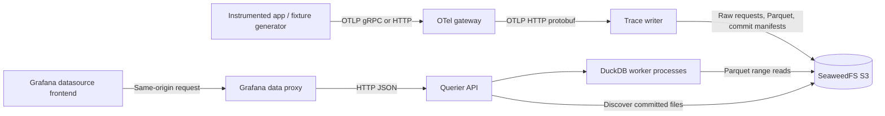

# Local object-storage tracing backend

Date: 2026-10-02  
Status: proposed implementation specification  
Scope: a reproducible MacBook PoC using Docker Compose

## 1. Decisions and requirements

Build the first end-to-end path with **DuckDB, immutable Parquet, and a publication manifest per bounded block-building cycle**. Run **SeaweedFS in its single-process `mini` mode** as the local S3-compatible datastore. Use a custom TypeScript Grafana datasource to translate the querier API into Grafana frames.

**Iceberg is not required for v1.** Keep one writer and append-only data. Introduce Iceberg before adding online file replacement, concurrent writers, or a shared DuckDB/Trino table. The v1 manifests are deliberately limited; do not grow them into a general table format.

| User requirement | Proposed implementation |
|---|---|
| Local MacBook, Docker containers | Docker Compose; native architecture images and containerized build/test tools |
| Object storage for traces | Raw OTLP and queryable Parquet in an S3 bucket; named Docker volume backs local storage |
| OTLP ingestion | Gateway exposes OTLP/gRPC on 4317 and OTLP/HTTP on 4318 |
| Minimal gateway processors | `memory_limiter`, then `batch`; configuration leaves room for later processors |
| Trino or DuckDB | DuckDB embedded in querier worker processes for v1; Trino evaluation is a later milestone |
| Iceberg decision | Defer under explicit single-writer, append-only constraints |
| Querier serving Grafana | Versioned HTTP API, engine adapter, bounded queries, canonical trace responses |
| Custom Grafana plugin | Datasource plugin with trace lookup, structured search, native trace waterfall, and contract tests |

Assumptions: one local tenant (`local`), modest test traffic, Docker allocated roughly 8 GiB RAM and 4 CPUs. These are starting budgets, not measured capacity. Confirm the actual host architecture and Docker allocation during implementation.

### v1 user journey

1. Start the stack and generate a known trace over OTLP.
2. Open the provisioned datasource in Grafana Explore.
3. Paste a trace ID or search by service, operation, span duration, and error status.
4. Open a search result in the native Grafana trace waterfall.
5. Inspect parent/child relationships, resource and span attributes, events, and links.
6. Restart the services and retrieve previously published traces.

Out of scope: logs/metrics ingestion, TraceQL, PromQL, arbitrary user SQL, production tenancy/authentication, HA, tail sampling, service graphs, alerting, online compaction, automatic retention deletion, and production-scale claims.

## 2. Architecture



The writer owns ingestion, normalization, and publication. The querier owns discovery, query semantics, SQL generation, limits, and canonical API responses. The plugin owns Grafana query controls and dataframe conversion. The gateway forwards OTLP and applies only resource protection and batching.

DuckDB is a library inside the querier workers, not an additional database server. Local spill files and metadata caches are disposable. Object storage contains all data needed to rebuild query state.

### Services and starting budgets

| Compose service | Role | Host ports, bound to 127.0.0.1 | Memory cap |
|---|---|---|---|
| `object-store` | SeaweedFS `mini`, persisted `/data` | 8333: S3 | 1 GiB |
| `storage-init` | Idempotent bucket/credential setup | None | Short-lived |
| `otel-gateway` | Collector contrib distribution | 4317, 4318 | 512 MiB |
| `trace-writer` | Python OTLP HTTP service and background publisher | None | 1 GiB |
| `querier` | Python HTTP API and two DuckDB worker processes | 8080 | 3 GiB |
| `grafana` | Grafana with bundled custom datasource | 3000 | 768 MiB |
| `tracegen` | Deterministic fixtures / load generator, optional profile | None | 256 MiB |

Use Python with FastAPI, the official OTLP protobuf package, PyArrow, an S3 client, and DuckDB. Use TypeScript/React with Grafana plugin tooling. Build dependencies and plugin assets in containers; host prerequisites are Docker with Compose and a shell.

Use named volumes for object storage, Grafana state, and bounded querier spill. Do not share a writable DuckDB database between containers. Provision datasource UID `object-storage-traces` and plugin ID `kasi-objecttraces-datasource`.

Before implementation milestone 1 is complete, pin exact image tags/digests, Python dependencies, DuckDB extensions, and Grafana npm packages in lockfiles. Verify Linux ARM64 on Apple Silicon and AMD64 on Intel. Do not silently rely on emulation or `latest`. Match Grafana package versions to the selected Grafana release, and record the corresponding source tag/commit for contract fixtures. Version selection and compatibility are implementation gates, not verified by this document.

SeaweedFS is selected because it provides a compact local S3 setup and DuckDB documents the integration. Verify PUT, GET, HEAD, paginated LIST, range reads, authentication, and read-after-write visibility against the pinned version. The application uses an endpoint/region/bucket configuration so another S3 implementation can replace it. [S1]

## 3. Gateway and OTLP contract

External endpoints:

- gRPC: `localhost:4317`, `TraceService/Export`.
- HTTP: `http://localhost:4318/v1/traces`, protobuf and OTLP JSON as supported by the standard receiver; include gzip coverage.
- Internal writer: `http://trace-writer:4318/v1/traces`, protobuf only. The gateway performs transport/encoding normalization.

Configure just the traces pipeline: `otlp receiver → memory_limiter → batch → OTLP HTTP exporter`. Bind container listeners to `0.0.0.0`; publish only the host ports above. Start with a 384 MiB memory-limiter threshold, 64 MiB spike allowance, one-second checks, batch trigger 1,000 spans, maximum 2,000 spans, and two-second timeout. Validate all component names and configuration fields with the pinned Collector binary. These are proposed settings. [S2]

Enable a bounded exporter queue and retry policy, with explicit queue capacity and retry duration in configuration. Record the Collector version's queue sizing unit. Add health checks and internal metrics. No attribute transforms, enrichment, filtering, or sampling by default. Future processors get named configuration entries and explicit ordering before batching.

**Acknowledgement boundaries:**

- A successful gateway response means the Collector accepted the request. With asynchronous batching/queues, this is not a guarantee that object storage has received it.
- A successful writer response means the raw protobuf request is durably stored according to the local object store's acknowledgement semantics. It does not mean Parquet publication has completed.
- Only committed Parquet is queryable. Report ingestion and publication lag separately.
- Collector crash can lose accepted in-memory batches/queue entries. A persistent exporter queue is a possible follow-up and still does not make an in-memory batch processor durable.
- Local Docker volume persistence is not protection against laptop/disk loss. v1 makes no end-to-end exactly-once claim.

Writer limits: 8 MiB decompressed request body, 10,000 spans per request, bounded in-flight uploads. Validate protobuf, IDs, supported timestamp range, and nonnegative durations before persistence. Reject an invalid request as a whole with the OTLP-defined nonretryable error response; include a useful validation reason. Use OTLP response protobufs, not a custom success JSON. Retryable storage failures return an OTLP-compatible 503; overload uses 429 with `Retry-After`. Enforce compressed and decompressed size limits. Test SDK/Collector retry behavior. [S3]

## 4. Object storage and publication

### Layout

Bucket: `traces`. All timestamps and partitions use UTC.

```text
raw/v1/tenant=local/<request-sha256>.pb
data/v1/tenant=local/ingest_date=YYYY-MM-DD/ingest_hour=HH/<block-id>-<part>.parquet
commits/v1/tenant=local/<block-id>.json
```

The request hash covers the decompressed protobuf bytes. It suppresses byte-identical retries only. Rebatching or equivalent protobuf encodings may create different hashes; logical deduplication is still required.

### Write protocol

1. Validate a request; upload raw bytes under its deterministic key. Never replace an existing raw object. On retry, verify the existing object rather than changing its first-received timestamp.
2. Acknowledge after successful raw persistence. A single background publisher discovers raw requests not covered by any committed block, including after restart. Use paginated listing; never rely on a lexicographic high-water mark for hash keys.
3. Accumulate whole raw requests into a bounded building cycle: seal at 10 seconds since its first request, 64 MiB decompressed input, or 100,000 spans, whichever comes first. Seal before adding a request that would exceed a size/count cap. These are PoC settings, not Tempo defaults. Keep normalized working memory below 256 MiB; use bounded staging/spill and backpressure when necessary.
4. Group spans from all requests in the cycle by trace ID, retaining individual span rows and their provenance. Sort by `(trace_id, start_time_ns, span_id)` and write Zstandard Parquet with an explicit Arrow schema. Keep a trace's rows together where file/row-group limits permit. Start with up to 64K rows per row group; oversized traces may span row groups and must be read from all matching groups. The path uses cycle creation time, not span start time, so an hour boundary does not force a trace apart. Event-time pruning uses metadata, never the directory name.
5. Upload immutable data files under a fresh block ID. Publish one immutable manifest only after every referenced file is readable. Include all source request keys/hashes, schema version, publication time, and file entries: key, checksum, size, row count, minimum span start, maximum span end, service names, and distinct trace IDs. Record request-to-block membership in this same manifest, not in separate completion markers.
6. The manifest commits the entire cycle, including every span in its listed raw requests. Queries must never glob `data/` and read uncommitted files. No raw request may be split across independently committed blocks in v1.

Only one publisher may run. The deployment must reject attempts to start a second publisher against the same dataset; a local process lock on the writer's shared state volume is adequate for this PoC. The writer state volume contains coordination only and is not needed to recover telemetry. Multi-host writers require a new design.

Empty valid requests return success without creating data. Recovery first reads all committed manifests to rebuild request membership, then replays uncovered raw requests into new cycles. Never republish a request already covered by a commit. Crash-abandoned files remain unreferenced. Membership is updated in memory only after manifest publication succeeds; on an ambiguous PUT outcome, check that commit key before retrying or starting another cycle. v1 has no online orphan cleanup, compaction, or object deletion. A full reset is an explicit developer command that removes the local dataset and volumes.

Gateway batching and storage block construction are separate controls. Grouping multiple OTLP requests reduces trace fragmentation and tiny Parquet objects. The 10-second cut still produces small files at low volume; measure file size, fragments per trace, and object requests. Late spans form a later fragment rather than mutating a committed block. No root-span arrival, idle interval, or block cut proves a trace is complete. See [the Tempo comparison](docs/tempo-trace-lifecycle.md).

### Discovery and read consistency

The querier polls all commit keys every two seconds using paginated LIST, fetching only unseen manifests. Apply each manifest transactionally to a disposable local metadata index. Store exact trace-to-file mappings from manifests; this supports ID lookup without scanning every Parquet file. This per-trace metadata grows with data volume and is explicitly a PoC limitation.

At query admission, capture an immutable set of discovered commit IDs and relevant file keys. All phases of that request use that set. New commits appear on the next request. This provides a stable view of discovered immutable files; it does not promise that every commit that exists in storage has already been discovered.

Do not declare ready until initial discovery completes. A failed refresh marks results stale with a warning and last successful refresh time; an unavailable referenced file fails the query. Never turn storage errors into empty successful results. A missing trace means “not found in the discovered published dataset,” not proof it was never ingested.

## 5. Span schema and correctness

One Parquet row represents one received span. Schema v1:

| Columns | Parquet representation |
|---|---|
| `schema_version`, `tenant_id` | INT32, UTF8 |
| `trace_id`, `span_id`, `parent_span_id` | Lowercase hex UTF8; 32, 16, nullable 16 characters |
| `name`, `service_name`, `service_namespace` | UTF8; namespace nullable |
| `start_time_ns`, `end_time_ns`, `duration_ns`, `received_at_ns` | INT64 nanoseconds |
| `kind`, `status_code`, `flags` | INT32, preserving OTLP enum values/flags |
| `status_message`, `trace_state` | UTF8 |
| `resource_schema_url`, `scope_schema_url` | UTF8 |
| `scope_name`, `scope_version` | UTF8 |
| `resource_attributes_json`, `span_attributes_json`, `scope_attributes_json` | UTF8 containing typed OTLP attribute arrays |
| `events_json`, `links_json` | UTF8 containing typed OTLP structures |
| `resource_dropped_attributes_count`, `scope_dropped_attributes_count`, `dropped_attributes_count`, `dropped_events_count`, `dropped_links_count` | INT32 |
| `source_request_id`, `source_span_ordinal` | UTF8 request hash, INT32 position |

Typed JSON retains OTLP AnyValue variants, including decimal strings for int64, base64 bytes, nested arrays/maps, and event/link metadata. Raw protobuf is retained as the fidelity source. Do not flatten resource and span attributes into one namespace or stringify every value. Missing `service.name` is represented as `unknown_service`; preserve original attributes unchanged.

Use exact integer arithmetic for timestamps. v1 accepts nonnegative times representable by signed INT64 and rejects out-of-range values explicitly. Wire API nanoseconds are decimal strings, avoiding JavaScript's unsafe integer range. Grafana conversion happens only at the plugin boundary.

Logical span identity is `(tenant_id, trace_id, span_id)`. Queries deduplicate before filters/aggregation. For conflicting copies, select greatest `(received_at_ns, source_request_id, source_span_ordinal)`; `received_at_ns` is the stable first raw-object receipt time. This is a deterministic PoC policy, not an OTLP revision protocol. Surface a conflict counter. Candidate-file pruning must not drop a newer conflicting copy within the requested scope: expand selected trace IDs to all their eligible files in the captured view before final deduplication and filtering. Unbounded lookup/search-summary expansion uses all indexed files for those IDs; bounded trace lookup limits eligibility to overlapping file intervals and reports the possibility of excluded fragments.

Persist raw spans promptly, then co-locate trace fragments during bounded block construction. Trace lookup supports both a time-scoped mode and an explicit all-retained mode. It uses the trace-to-file index and file time bounds before reading Parquet; it does not scan every retained span. Merge all matching fragments in the selected scope rather than stopping at the first match.

Optional `start` and `end` restrict candidate files using their minimum span start and maximum span end. Include a file if `min_start < end && max_end >= start`; conservative over-inclusion is acceptable. Within selected files return every span for that trace ID, including spans outside the requested interval: this is file selection, not span trimming. A late arrival is selected by span event time, not publication time. A fragment outside the range can still be omitted; expose this in response metadata and offer an explicit wider lookup.

Missing parents, multiple roots, and cycles produce warnings. Even a connected graph and observed root cannot establish that no more spans will arrive. Keep `completeness: unknown`. Events and links survive conversion.

**Freshness boundary:** v1 queries committed object-store blocks only. Grouping adds up to one building cycle plus conversion/upload/discovery latency. Tempo also serves recent unflushed data from ingesters/live-stores. A comparable recent-data path is a follow-up, requiring bounded trace state, raw-request replay, merging/deduplication with published blocks, and an explicit handoff protocol that prevents gaps during publication. Do not claim immediate trace visibility or introduce an untested best-effort hot cache. If sub-cycle visibility becomes a requirement, implement this path before lengthening block windows.

## 6. Querier API and execution

### API surface

| Endpoint | Contract |
|---|---|
| `GET /healthz` | Process is live |
| `GET /readyz` | Initial discovery complete, worker pool available, storage access checked |
| `GET /api/v1/status` | Engine, schema version, last successful discovery, published file/row counts |
| `GET /api/v1/traces/{traceId}?start=...&end=...` | Optional paired RFC3339 bounds select files; omit both for explicit all-retained lookup |
| `POST /api/v1/search` | Structured span predicates, returning distinct matching trace summaries |
| `GET /api/v1/services?start=...&end=...` | Distinct services for a bounded start-time range |
| `GET /api/v1/operations?service=...&start=...&end=...` | Distinct operations with service and range restrictions |
| `GET /metrics` | Internal diagnostic counters and histograms |

Search example:

```json
{
  "start": "2026-10-02T00:00:00Z",
  "end": "2026-10-02T01:00:00Z",
  "serviceName": "checkout",
  "operationName": "POST /checkout",
  "status": "error",
  "minSpanDurationMs": 100,
  "limit": 100
}
```

Time is `[start, end)` on span start. All supplied predicates must match the same deduplicated span. Duration is span duration, not trace duration. Error means OTLP status `ERROR`. Operation/service matches are exact; arbitrary attribute expressions and regex are deferred.

Search first identifies matching trace IDs, then computes summaries from all published spans for those IDs in the same captured view. Summary fields: `traceId`, `rootServiceName` and `rootOperationName` (nullable when ambiguous/absent), `startTimeUnixNano`, `durationNano` (max end minus min start), `spanCount`, `errorSpanCount`, and `matchedSpanCount`. These describe available spans, not guaranteed complete traces. Sort by trace start descending then trace ID ascending, applying the requested result limit after this ordering. Bound candidate count and total file bytes before summary expansion; return an explicit limit error if exceeded.

Trace lookup requires both bounds or neither; reject one-sided or non-increasing ranges. Bounded lookup has the same 24-hour maximum range as search; all-retained lookup remains available under the normal query budgets. Never silently widen a bounded request or automatically fall back on an empty result. A bounded 404 includes the requested scope and a suggestion to widen.

Canonical trace response shape:

```json
{
  "apiVersion": "v1",
  "traceId": "0123456789abcdef0123456789abcdef",
  "spans": [],
  "meta": {
    "engine": "duckdb",
    "viewId": "opaque-hash-of-discovered-commits",
    "catalogRefreshedAt": "2026-10-02T01:00:00Z",
    "lookupScope": "all_retained",
    "requestedRange": null,
    "excludedIndexedFiles": 0,
    "completeness": "unknown",
    "warnings": [],
    "elapsedMs": 12
  }
}
```

For bounded lookup, `lookupScope` is `time_range` and `requestedRange` contains the supplied bounds. `excludedIndexedFiles` counts known files for this ID removed by time pruning in the captured view; a positive count requires a visible warning. Zero does not establish completeness or account for undiscovered/unpublished data.

Each span uses the schema's semantic fields in camelCase; the four time fields are decimal strings with explicit `UnixNano`/`Nano` suffixes. Parse JSON storage columns into typed attribute/event/link arrays. Do not expose source object credentials or SQL. Define this shape in OpenAPI and generate/shared-test TypeScript response types during implementation.

Errors use `{ "error": { "code": "...", "message": "...", "retryable": false }, "requestId": "..." }`. Use 400 for malformed filters/IDs, 404 for trace not found, 422 for query budget exceeded, 429 for queue saturation, 503 for unavailable storage/catalog, and 504 for timeout. Empty successful searches return an empty list. Result limiting reports `hasMore` by fetching limit+1; v1 has no pagination cursor and never silently truncates a trace.

### Starting limits

- Default search range: last hour; maximum: 24 hours.
- Search results: default 100, maximum 1,000; candidate trace IDs: maximum 10,000.
- Trace detail: maximum 10,000 spans and 20 MiB serialized response; otherwise explicit limit error.
- Per query: at most 2,000 files and 2 GiB total candidate file size, including all expansion phases. This is a conservative input budget, not actual projected bytes read.
- Two executing queries, 16 queued, 30-second total deadline including queue time.
- Each isolated worker: one active DuckDB connection, two threads, 1 GiB DuckDB memory limit, bounded spill directory. Process/container limits cover allocations outside DuckDB's memory manager.
- Autocomplete endpoints: maximum 1,000 values, explicit `hasMore`; same scan/deadline budgets.

Use prepared parameters for values, an allowlist of filter/column names, and file keys obtained only from validated manifests. Build explicit S3 file lists; avoid bucket-wide globs. Bake the required DuckDB S3 extension into the image so query execution does not depend on runtime extension downloads.

API cancellation must interrupt the active worker query; if it does not terminate promptly, kill and replace that isolated worker. A timeout must not leave expensive scans running. HTTP disconnect propagation through the Grafana proxy is an integration test; the server deadline remains authoritative even if disconnect propagation is unavailable.

Define an internal engine adapter with `getTrace`, `searchTraces`, `listServices`, and `listOperations`. The adapter owns engine-specific SQL and cancellation. Keep externally observable filtering, deduplication, ordering, limits, and precision consistent across future engines.

## 7. Grafana datasource and trace frames

Implement a **datasource plugin**, using Grafana's existing trace visualization. No custom waterfall panel is needed. `plugin.json` declares datasource type and tracing support. Implement `query`, `testDatasource`, query editor, configuration editor, and search-result links back to trace lookup.

The browser calls Grafana's same-origin datasource proxy using `getBackendSrv().fetch` and the configured datasource URL. Grafana connects to `http://querier:8080` over the Compose network. The browser must not resolve Docker service names or call S3. This frontend datasource does not require a Go plugin backend for v1. [S4]

Two query modes:

- **Trace ID:** produce one span dataframe. Default to the Grafana time picker with explicit “Selected time range” scope; provide an “All retained data” option. Display active scope and partial-data warnings.
- **Search:** produce a table with internal datasource links carrying `{ queryType: "trace", traceId, lookupScope: "time_range", start, end }`. Derive the range from the available trace summary start/end, padded by one minute each side (clamp the lower bound to epoch). If padding exceeds the maximum range, link to explicit all-retained mode. The padding is our heuristic, not a Tempo guarantee. Keep the range in query state; do not silently substitute the current time picker. Offer “Search all retained data” for missing fragments. Use supported Grafana link APIs.

The supplied `dataFrame.ts` and dataplane documentation define the generic frame container. Trace rendering additionally depends on `TraceSpanRow` in `trace.ts` and frame metadata from `data.ts`. Pin and test all against the chosen Grafana release; links to `main` are research references, not a stable version contract. [S5–S8]

### Trace dataframe mapping

One row per deduplicated span; equal-length field arrays; `refId` copied from the query. Set `meta.preferredVisualisationType = "trace"`. Sort rows by start time then span ID. Do not invent a dataplane `meta.type` without support in the pinned release.

| Grafana field | FieldType | Mapping |
|---|---|---|
| `traceID`, `spanID` | string | Hex identifiers |
| `parentSpanID` | string | Parent; undefined for root |
| `operationName`, `serviceName`, `serviceNamespace` | string | Name and resource service identity |
| `startTime` | number | Epoch milliseconds |
| `duration` | number | Milliseconds |
| `serviceTags`, `tags` | other | Resource/span key-value arrays |
| `logs`, `references` | other | Events and linked spans |
| `kind` | string | OTLP kind name |
| `statusCode`, `statusMessage` | number, string | OTLP status |
| `instrumentationLibraryName`, `instrumentationLibraryVersion` | string | Scope name/version |
| `traceState`, `warnings` | string, other | Trace state and diagnostics |

Use quotient/remainder integer conversion for nanoseconds to milliseconds; preserve fractional milliseconds where representable. This visualization boundary is allowed to lose precision; stored and API values remain exact. Duration 1,500,000 ns becomes 1.5 ms. Event timestamps use epoch milliseconds too.

Convert attributes into `{key, value, type?}` pairs. Preserve booleans/numbers/objects; display int64 values outside JavaScript's safe range as decimal strings with type information. Bytes retain a base64 representation. Events become logs with timestamp, name, and attribute fields. Links become references retaining target trace/span IDs and attribute tags. Include scope attributes and dropped counts in diagnostics without conflating them with span attributes.

For an OTLP error span, ensure the displayed tags contain boolean `error: true` in addition to status fields. Preserve a conflicting original attribute in canonical API data and explain the synthetic display tag in plugin documentation. Missing parents and malformed trees get visible notices. Search frames use table presentation and separate unit configuration for time/duration.

Local development permits only this named unsigned plugin via Grafana configuration. Provision the datasource and a small trace/search dashboard. A fresh Compose startup must not require manual plugin installation or datasource setup.

## 8. Why defer Iceberg, and how Trino fits

Parquet is the columnar file format. Iceberg adds table metadata, snapshots, schema/partition evolution, and commit semantics over those files. It does not automatically create a trace-ID search index or make small files disappear. Maintenance still needs scheduling. [S9]

| Choice | Benefit | Cost / constraint | Decision |
|---|---|---|---|
| DuckDB + Parquet + bounded manifests | Small local stack, direct file reads, easy debugging | We implement publication/discovery; single writer; no replacement | v1 |
| DuckDB + Iceberg | Standard table snapshots and maintenance path | Catalog and writer integration; verify extension feature compatibility | Introduce when table lifecycle needs justify it |
| Trino + Iceberg | Standard shared table plus distributed SQL | More containers/RAM, catalog, coordination | Later comparison profile |
| Trino + Hive/Parquet | Can query registered external Parquet tables | Metastore/partition management; less useful for the intended evolution | Not the preferred follow-up |

Trino does not require Iceberg, but it needs an appropriate connector/catalog to understand the data. Switching from direct DuckDB file reads to Trino is not just an environment variable. The proposed follow-up adds an Iceberg REST catalog with persistent backing state, an Iceberg-aware writer, and Trino's Iceberg connector. Trino documents REST catalog and S3 configuration support. [S10]

Adopt Iceberg **before** multiple independent publishers, concurrent compaction/retention, or readers that must share a standard transactional table view. Use an explicit migration: pause ingestion, import or rewrite committed deduplicated data, validate schema and counts, switch writer/querier to Iceberg snapshots, then resume. Preserve raw OTLP for replay. Freeze the v1 dataset during migration; do not maintain two independent authoritative commit systems.

For a fair later engine comparison, run both against the same Iceberg snapshot, file layout, filters, and result semantics. Test extension/catalog compatibility first. A single-node Trino container can validate SQL/API integration on a laptop; it cannot demonstrate distributed scaling. Adding coordinator/worker containers on one laptop still shares CPU, disk, and networking.

## 9. Diagnostics and performance evaluation

Expose writer counters for accepted/rejected spans, raw uploads, raw-to-publication lag, retries, uncommitted raw objects, and publication failures. Expose querier counters/histograms for queue delay, execution time, timeouts, cancellations, cache refresh failures, candidate files/bytes, result size, and deduplication conflicts. Never label metrics with trace IDs or arbitrary attribute values.

Measure actual S3 request/byte counts using storage instrumentation where available; distinguish these from candidate file size. Structured logs include request/query IDs and error categories. Keep health endpoints separate from readiness. No separate monitoring stack is required for the first iteration.

Initial benchmark fixture: 10,000 traces, about 100,000 spans, five services, parent/child spans, errors, events, links, and delayed arrivals. Use seeded generation and record actual bytes, file counts, attributes per span, Mac model, Docker CPU/RAM, image versions, and whether caches are warm. Include publication-size experiments to expose the small-file tradeoff.

Unverified targets at one active query on that fixture:

- p95 writer acceptance-to-query-visibility under 15 seconds in steady state, including the 10-second block-building window. Immediate recent-data lookup is not a v1 target.
- p95 exact trace lookup under 2 seconds.
- p95 one-hour selective search under 5 seconds.

Also measure p50/p95/p99 at concurrency 1, 2, and 4; record queues and failures. Distinguish cold application caches from cold host/VM page caches. These are goals for iteration, not promises or reasons to change correctness limits silently.

## 10. Implementation milestones and acceptance

### M0 — Pin dependencies and prove compatibility

- Record architecture, Docker budget, pinned images/packages, and Grafana source revision.
- Verify S3 operations and DuckDB remote Parquet range reads.
- Render a hand-authored trace frame through the custom plugin in pinned Grafana.
- Validate Collector configuration with its own validation command.

Exit: storage and Grafana contracts proven before building the full pipeline.

### M1 — Ingestion and publication

- Compose storage, bucket setup, gateway, writer, and trace generator.
- Implement raw persistence, bounded multi-request block construction, trace co-location, explicit Parquet schema, and atomic request-membership manifests.
- Test gRPC and HTTP protobuf/JSON through the gateway, plus compressed input.
- Simulate a writer crash after raw persistence and after data upload; recover without lost committed spans or reading uncommitted files.

Exit: generated trace fixtures appear in committed Parquet; writer acknowledgements and gateway loss boundaries are documented and tested.

### M2 — Querier

- Implement metadata reconstruction, trace lookup, structured search, autocomplete, and API schema.
- Test deduplication across different batches, conflicting copies, cross-hour traces, late spans, missing parents, and exact nanosecond persistence.
- Test no results, malformed requests, storage outage, oversized trace, query limits, cancellation, and pool recovery.
- Verify fragments across cycles and hours are combined. Verify bounded lookup selects by file event-time overlap, does not trim returned spans, reports excluded indexed files, and differs deliberately from all-retained lookup. Test late publication with old event timestamps and no automatic widening.
- Delete disposable querier state and prove recovery solely from object storage.

Exit: canonical API responses match fixture expectations, including summaries and ordering.

### M3 — Grafana integration

- Implement editors, proxy access, conversion, query cancellation, and trace links.
- Assert field names/types/lengths, IDs, parent mapping, millisecond conversion, typed tags, error marking, events, and references.
- Browser integration test: search → select trace → inspect waterfall, event, and linked trace.
- Cover an empty search, unknown ID, stale discovery notice, query error, selected-range lookup, summary-derived trace links, and explicit all-retained retry.
- Verify both Explore and the provisioned dashboard trace view visually on the pinned release.

Exit: a fresh startup supports the entire user journey without manual configuration.

### M4 — Reproducibility and benchmarks

- Implement `make up`, `make down`, `make smoke`, `make test`, `make benchmark`, and explicit destructive `make reset` commands.
- Preserve data on ordinary down/up; reset is separately documented.
- Run the baseline benchmark and record results rather than claiming the targets passed.
- Document observed bottlenecks and decide whether the next experiment is file sizing, indexing, or Iceberg/Trino.

### Planned repository layout

```text
README.md
SPEC.md
compose.yaml
.env.example
Makefile
config/otel-gateway.yaml
config/grafana/provisioning/
services/trace-writer/
services/querier/
packages/trace-schema/
plugins/kasi-objecttraces-datasource/
tools/tracegen/
tests/fixtures/
tests/integration/
benchmarks/
```

The application files and commands above are deliverables for implementation; they do not exist merely because this spec names them.

## 11. Decisions to revisit after the first measurement

1. Is measured discovery/manifest growth acceptable for the intended dataset? If not, evaluate standard table metadata and a dedicated trace lookup index.
2. Does query latency come mainly from S3 requests, Parquet scans, deduplication, or queuing? Change the responsible layer before introducing distributed execution.
3. Is gateway crash durability necessary for the next use case? If so, explicitly redesign the acknowledgement/buffering path.
4. Are arbitrary attributes, TraceQL, multi-tenancy, or historical analytics actually required? Each changes the storage/query contract and deserves a scoped extension.

## 12. Primary references

The [Tempo lifecycle comparison](docs/tempo-trace-lifecycle.md) records the research behind the revised block-building and lookup contracts, including the distinction between Tempo 2.x and 3.0.

Checked 2026-10-02. Implementation must recheck version-specific behavior against pinned releases.

- **S1:** [DuckDB: SeaweedFS integration](https://duckdb.org/docs/current/guides/network_cloud_storage/seaweedfs_import) and [SeaweedFS repository](https://github.com/seaweedfs/seaweedfs).
- **S2:** [Collector configuration](https://opentelemetry.io/docs/collector/configuration/), [batch processor](https://github.com/open-telemetry/opentelemetry-collector/tree/main/processor/batchprocessor), and [memory limiter](https://github.com/open-telemetry/opentelemetry-collector/tree/main/processor/memorylimiterprocessor).
- **S3:** [OTLP specification](https://opentelemetry.io/docs/specs/otlp/).
- **S4:** [Grafana datasource tutorial](https://grafana.com/developers/plugin-tools/tutorials/build-a-data-source-plugin) and [Grafana data proxy](https://grafana.com/developers/plugin-tools/how-to-guides/data-source-plugins/fetch-data-from-frontend).
- **S5:** [Grafana dataframe types — supplied reference](https://github.com/grafana/grafana/blob/main/packages/grafana-data/src/types/dataFrame.ts).
- **S6:** [Grafana dataplane dataframes — supplied reference](https://grafana.com/developers/dataplane/dataframes).
- **S7:** [Grafana TraceSpanRow contract](https://github.com/grafana/grafana/blob/main/packages/grafana-data/src/types/trace.ts).
- **S8:** [Grafana frame metadata](https://github.com/grafana/grafana/blob/main/packages/grafana-data/src/types/data.ts) and [Traces in Explore](https://grafana.com/docs/grafana/latest/visualizations/explore/trace-integration/).
- **S9:** [Apache Iceberg specification](https://iceberg.apache.org/spec/).
- **S10:** [Trino Iceberg connector](https://trino.io/docs/current/connector/iceberg.html).
- [DuckDB Parquet reader](https://duckdb.org/docs/current/data/parquet/overview) and [workload tuning](https://duckdb.org/docs/current/guides/performance/how_to_tune_workloads).
